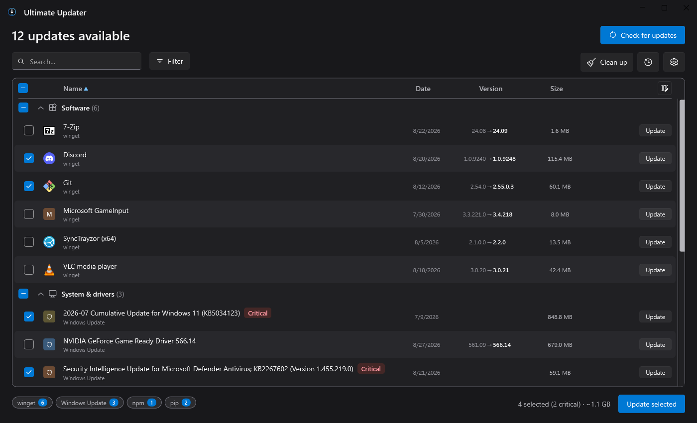
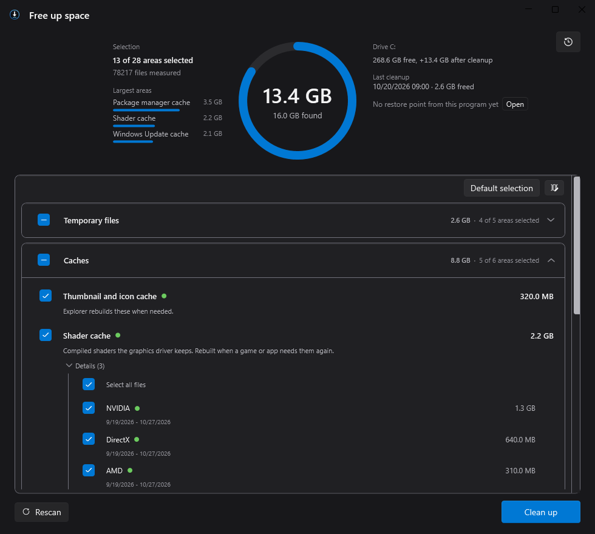

<p align="center">
  
</p>

<h1 align="center">Ultimate Updater</h1>

<p align="center">
  All updates on your Windows PC in one list.
</p>

<p align="center">
  <a href="https://github.com/wbgcoding/UltimateUpdater/releases/latest"><strong>Download the latest release</strong></a>
</p>

<p align="center">
  <a href="https://github.com/wbgcoding/UltimateUpdater/releases/latest"></a>
  
  
  
  
</p>

<p align="center">
  
</p>

Ultimate Updater checks winget, Windows Update, drivers, the Microsoft Store, developer package managers
and game launchers, and lists everything that is out of date in one table. Tick what you want and update
it in one go. A separate cleanup window frees disk space and runs Windows' own maintenance tools.

## What it does

- Lists updates from more than 50 sources in one table: apps, Windows and driver updates, developer tools,
  games and Store apps, grouped by category, searchable and sortable. The Filter menu narrows the table,
  for example to critical updates only. Ignored updates stay hidden until you ask for them.
- Installs whatever you tick. Admin installs in the same batch share one UAC prompt. Click the new version
  of a row to read its release notes.
- Uses each source's own install mechanism, so winget's manifest hashes, Windows Update's signatures and
  each package manager's checks still apply.
- Scheduled scans only notify: nothing is installed until you click. The one exception is Scoop, which
  refreshes its buckets before listing; that refresh can also update Scoop itself.
- Never invents a version number. Game launchers and the Store get an "Open" button that takes you to
  their own update page.
- Comes with a cleanup window for temp files, caches, old drivers, old Python versions, the component
  store, drive optimisation and system repair, each with its size and a risk level.
- Lets you undo: an optional restore point before the first admin batch, a registry backup before
  registry cleanup, a driver export before a driver package is removed, and a rollback to the previous
  version for winget packages.
- Follows the Windows light or dark theme, sits in the tray and speaks eleven languages (English, German,
  Spanish, Italian, Portuguese, Polish, Simplified Chinese, Japanese, Dutch, Turkish, Romanian).

## Cleanup

<p align="center">
  
</p>

Every entry shows its size and a risk level: safe, moderate or risky. Safe entries start ticked, together
with Windows' standard component store cleanup; nothing else ever is, and "Default selection" restores
that set at any time. System repair (`sfc`, DISM) starts unticked as well: it frees no space and takes a
long time, so you opt in when you want it.

- Temporary files, crash dumps, thumbnail and shader caches, package-manager and build-tool caches
- Recycle bin, by default only files deleted more than 30 days ago (adjustable); a switch in Settings sends cleaned
  files to the recycle bin instead of deleting them for good
- Windows Update and Delivery Optimization caches, setup and servicing logs, Windows Disk Cleanup
- Component store cleanup (DISM) with an analysis of what it would free, optional ResetBase
- Drivers of devices that are no longer connected and driver packages no device uses, each exported to a
  backup first, with version, date and the currently installed driver for comparison
- Leftovers of interrupted pip installs and, optionally, older Python versions
- Orphaned registry entries, always after a registry backup
- Drive optimisation (TRIM for SSDs, defragmentation for hard drives) and system repair (`sfc`, DISM)

You can close the window while a cleanup runs; the toolbar button keeps spinning until it is done.

## Supported sources

| Group | Sources | What it does |
| --- | --- | --- |
| Apps | winget, Chocolatey, Scoop | List and install |
| Windows | Windows Update (quality, driver and definition updates, never feature upgrades) | List and install |
| Drivers | NVIDIA GeForce (signature and hash checked), driver updates from Windows Update | List and install |
| Python | pip (every installed interpreter), pipx, uv tools and uv itself, pyenv-win | List and install |
| JavaScript | npm, pnpm, Volta, Bun, Deno | List and install |
| Developer tools | .NET tools, PowerShell Gallery, RubyGems, Composer, rustup, vcpkg, mise, Flutter, Android SDK, Google Cloud SDK, GitHub CLI extensions, VS Code extensions, tools released on GitHub, Ollama models | List and install |
| Games | Steam | Pending game updates, installing stays with Steam |
| Launchers and stores | Microsoft Store and Xbox, Epic Games, GOG Galaxy, Battle.net, EA app, Ubisoft Connect, Rockstar, Riot, Amazon Games, itch.io, Minecraft, Paradox, Roblox, HoYoPlay, Wargaming.net, Garena, JetBrains Toolbox, Docker Desktop, Unity Hub, Android Studio | Detect and open |
| WSL | Windows Subsystem for Linux | Detected, updates stay with WSL |

A source only appears when its tool is already installed: nothing is downloaded or started just to find out.
One failing source never stops the others, and a package owned by two managers (pip and uv, for example)
appears once and installs through its owner. [`docs/MANUAL.md`](docs/MANUAL.md) explains the table, the
tiers and the cleanup categories in detail.

## Install

[Download the latest release](https://github.com/wbgcoding/UltimateUpdater/releases/latest) and choose one:

| Download | What it is |
| --- | --- |
| `UltimateUpdater.exe` | Portable, x64, no installation, keeps its data in `data\` next to itself |
| `Setup-UltimateUpdater-<version>.exe` | Installer for x64 and ARM64: all users, just you, or a portable copy |

Requirements: Windows 10 1809 or newer. The .NET runtime is included, nothing else is needed.

Check a download against `SHA256SUMS.txt` from the same release:

```powershell
(Get-FileHash ".\UltimateUpdater.exe" -Algorithm SHA256).Hash.ToLower()
```

Until the app is code-signed, SmartScreen warns on first start: *More info*, then *Run anyway*, once the
hash matches.

The app updates itself from this repository's releases; a download is only applied when it matches
`SHA256SUMS.txt`.

## Security model

An updater starts other people's installers with administrator rights. How the app keeps that safe:

- The main app never runs elevated. Admin work goes to one elevated helper over a named pipe that
  authenticates both ends; no job file is written to disk that could be swapped in between.
- An elevated launch never resolves a tool through `PATH`, only through fixed, verified locations.
- The helper never runs uninstall commands taken from the user's own registry hive.
- Self-updates fail closed: a missing or mismatching checksum stops the update.

Found a security problem? Please report it privately, see [`SECURITY.md`](SECURITY.md).

## Privacy

No telemetry, no account, no ads. Nothing about you or your PC is sent to the author. The app talks to:

- the update sources installed on your PC, through their own registries and feeds (for example winget,
  PyPI, npm, Windows Update),
- the download hosts those sources name, with a header-only request to show the download size,
- NVIDIA's driver lookup, which receives your GPU model and Windows version, when an NVIDIA GPU is present,
- GitHub, for the app's own update check and, when you ask for it, to repair winget.

Each of these hosts sees your IP address, as with any download. When the Windows proxy fails, requests are
retried without it and the log notes that. Settings, history and logs stay on your PC, and the log redacts
user paths and anything shaped like a credential.

## Where it keeps things

| Mode | Data folder |
| --- | --- |
| Installed | `%APPDATA%\UltimateUpdater` |
| Portable | `data\` next to the executable |

Settings, install history, driver backups and logs live there. Uninstalling leaves the folder
behind; *Reset everything* in Settings clears caches, history and logs, or delete the folder yourself.
The folder can be moved in Settings. After a crash, a short redacted note goes to
`%TEMP%\UltimateUpdater-crash.log`.

Two kinds of backup live elsewhere: registry backups go to `%APPDATA%\UltimateUpdater\registry-backups`
(portable copies included; the folder can be changed in Settings), and every driver backup is also kept
where the elevated helper exported it, `%ProgramData%\UltimateUpdater\driver-backups`, which uninstalling
leaves behind as well.

<details>
<summary><strong>Building from source</strong></summary>

Requirements: the .NET 10 SDK, Python with Pillow (app icon) and
[Inno Setup](https://jrsoftware.org/isinfo.php) (installer). The version number lives only in
`src/UltimateUpdater/UltimateUpdater.csproj`.

```
build.bat
```

`build.bat` in the repository root is the single build: Release build and tests, icon, single-file
self-contained executables for x64 and ARM64, the installer and checksums. `dist\` ends up holding:

| File | What it is |
| --- | --- |
| `UltimateUpdater.exe` | portable build (x64) |
| `Setup-UltimateUpdater-<version>.exe` | installer with both architectures |
| `SHA256SUMS.txt` | checksums for both |
| `sbom.json` | bundled libraries and versions, for licence and vulnerability checks, not shipped |

Without Inno Setup everything except the installer is still produced. To sign, set `WU_SIGN_THUMBPRINT`
to a code-signing certificate's thumbprint in your certificate store (optionally `WU_SIGN_TIMESTAMP_URL`).
In automated runs set `WU_NOPAUSE=1`. A GitHub Actions workflow (`.github/workflows/release-build.yml`)
builds and tests on a clean runner, by hand or on a version tag only.

Portable executable only, without tests, icon or installer:

```
dotnet publish src\UltimateUpdater\UltimateUpdater.csproj -c Release -r win-x64 --self-contained true -p:PublishSingleFile=true -p:IncludeNativeLibrariesForSelfExtract=true -o dist
```

</details>

<details>
<summary><strong>Deliberate limits</strong></summary>

- Driver rows only exist where a real version can be determined (NVIDIA, Windows Update) or the vendor's
  own tool is installed. There are no rows that merely open a web page.
- ASUS mainboard drivers are not covered: ASUS offers no queryable driver feed. Use MyASUS or Armoury
  Crate; chipset, network and audio drivers usually arrive through Windows Update anyway.
- pnpm and pyenv-win, as well as the JetBrains Toolbox, Docker Desktop and Unity Hub launchers, were built
  from each tool's documentation rather than a real install. If one of them misses an update or an install,
  an issue with the real tool output or install path helps fix it.

</details>

## Reporting an issue

Open an [issue](https://github.com/wbgcoding/UltimateUpdater/issues) with what you expected and what
happened, the app version (Settings, About), portable or installed, the source involved and the relevant
log lines. The log sits in the data folder and already redacts paths and credentials.

## Disclaimer

This software only lists updates and starts them through each source's own
mechanism (for example winget, Windows Update, package managers, game
launchers and vendor tools). It does not create, host, check or modify the
packages, installers, drivers or other content those sources deliver. The
authors and copyright holders are not responsible for that content or for any
damage, data loss, downtime or other harm caused by updates, installs,
removals or cleanup actions carried out with this software. You decide what to
install or remove and use the software at your own risk.

See [`LICENSE`](LICENSE) for the licence itself.

## Trademarks

Not affiliated with, endorsed or sponsored by Microsoft, NVIDIA, Valve, Epic Games or any other vendor
named in the app. Product names and trademarks belong to their owners and only identify the update or
launcher a row refers to. Brand marks come from [Simple Icons](https://github.com/simple-icons/simple-icons)
under CC0 (see [`NOTICE-brand-icons.md`](NOTICE-brand-icons.md)); bundled libraries are listed in
[`NOTICE-dependencies.md`](NOTICE-dependencies.md).

## Licence

[MIT](LICENSE) © 2026 BGCoding
